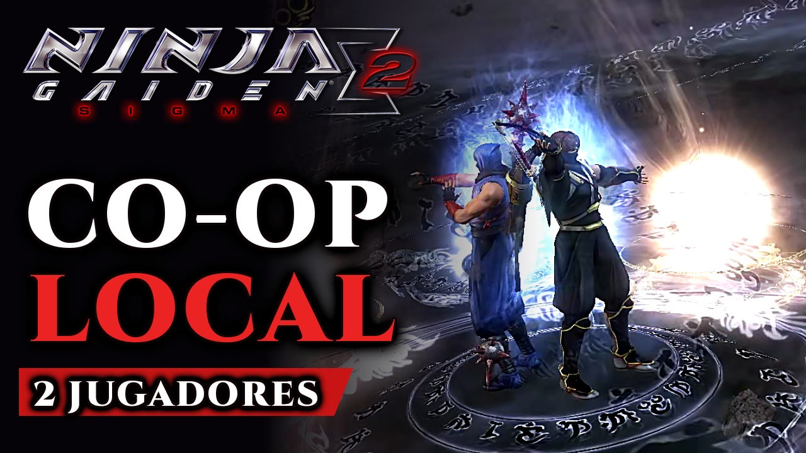
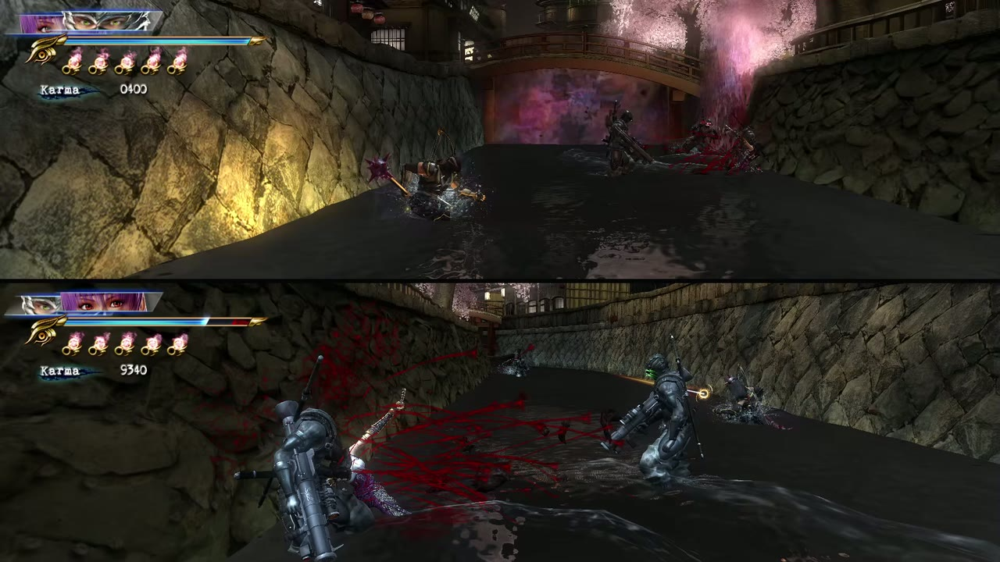
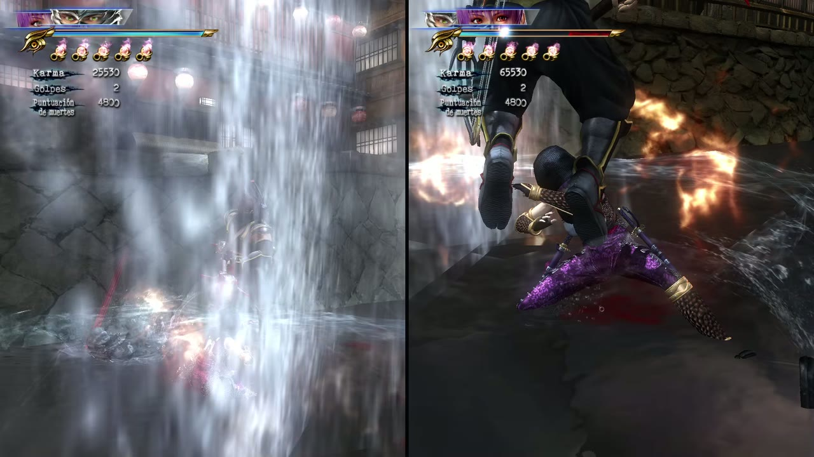
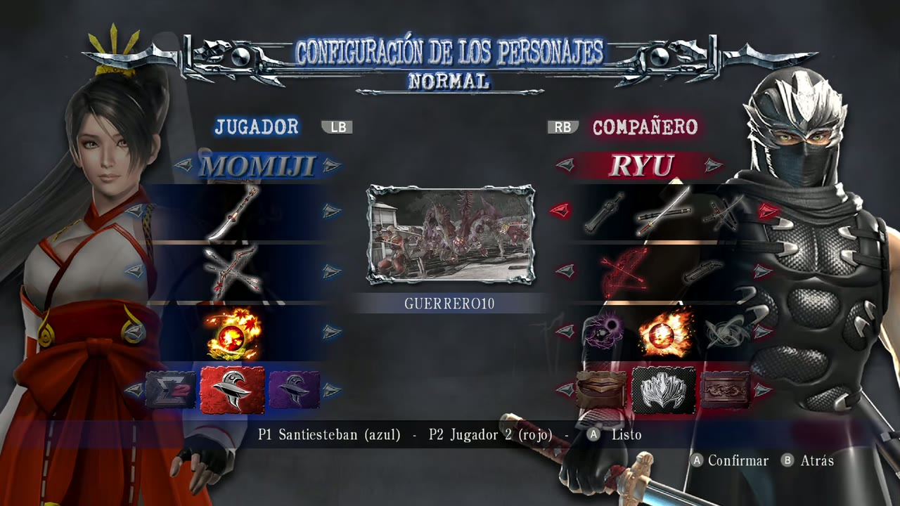
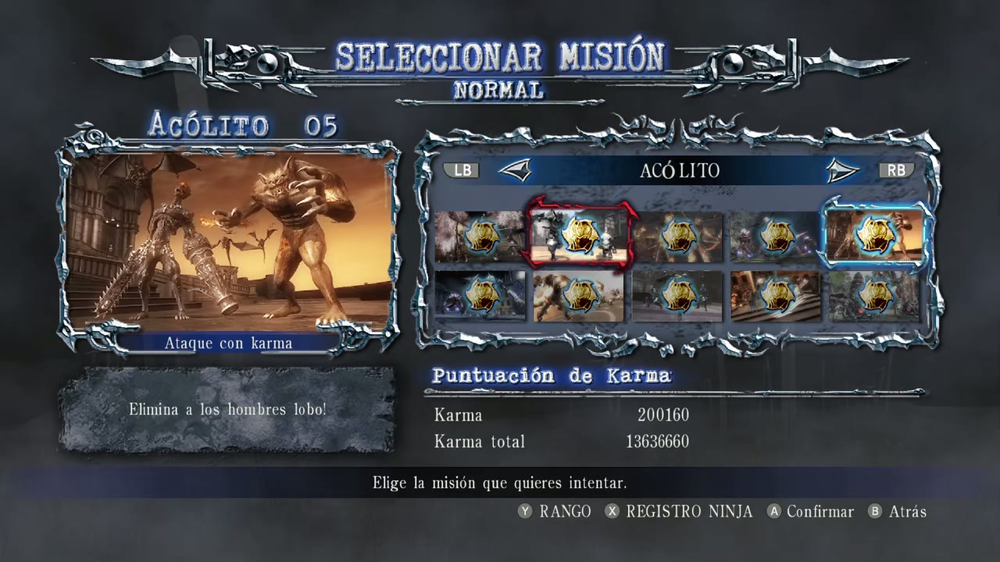
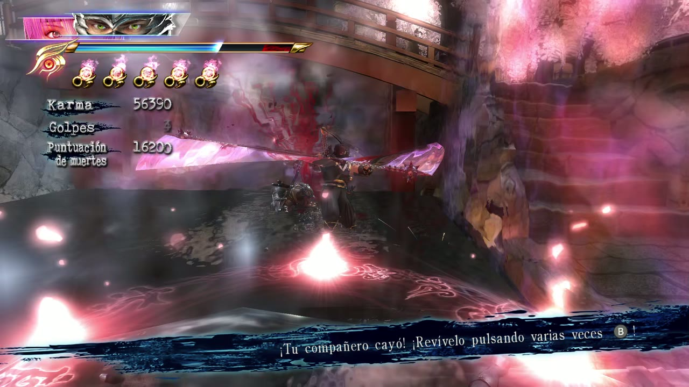
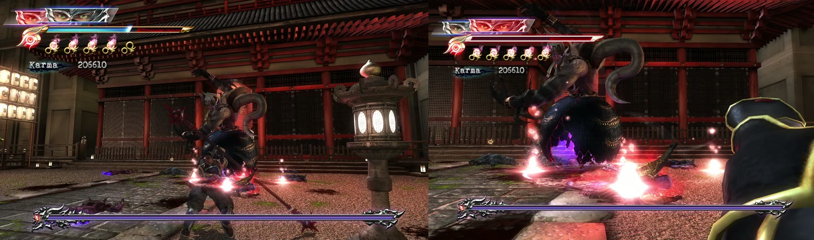

# NGS2 Co-op

**English** · [Español](README.es.md)

**Version 1.2** · [Nexus Mods](https://www.nexusmods.com/ninjagaidenmastercollection/mods/549) · [Trailer (YouTube)](https://youtu.be/VQ-9o8vhL5I)

Local co-op mod for **NINJA GAIDEN Σ2** (NINJA GAIDEN: Master Collection, Steam). In Team Missions a second
player takes control of the AI partner with their own controller, and each player gets their own camera:
split screen on one monitor, or one monitor per player.

| | |
|---|---|
|  Horizontal split screen |  Vertical split screen |
|  Both players set up their character at once |  Player 2's red box on the mission select |
|  Revive your partner |  One monitor per player |

Built on top of [NM Plugins](https://github.com/nm004/ngs2-nm-plugin) by Nozomi Miyamori (plugin loader,
gore effects and bug fixes). The original README is kept in [docs/NM_PLUGINS_README.md](docs/NM_PLUGINS_README.md).

## Features

- **Player 2 joins with BACK** on any connected controller and takes over the Team Mission partner
  (movement, attacks, jumps, ninpo: the game's own controls). BACK again hands the partner back to the AI.
- **Hot-plugged controllers** work; the controller that presses BACK becomes player 2.
- **Shared menus:** either controller can drive the menus. On the character screen each player picks their
  own column. On the mission select player 2 has a **red selection box drawn by the game** next to player 1's,
  changes page with LB/RB, and player 1 cannot go on until player 2 has picked (a coin flip decides if they differ).
- **Character screen for two:** both players set up their character at the same time, each with their own
  cursor always visible (blue for player 1, red for player 2). A marks a player ready (B undoes it): a band of
  their colour lights up under their column and the help line says who is ready; with both ready the mission starts.
- **On-screen notices:** "press BACK to join" while the game starts; player names once player 2 has joined.
- **Split screen** while player 2 plays:
  - *Vertical* (side by side) or *horizontal* (top and bottom); the views never mix.
  - *One monitor per player*: player 1 on the game's monitor, player 2 full screen on the other one.
  - Detected automatically: two monitors → one per player, one monitor → split screen.
  - **L3 + R3** (both stick clicks) on either controller switches the layout; the choice is remembered.
  - Each player sees **their own HUD** (portrait, health, ki, ninpo), scaled down in split screen.
  - The pause menu stays full size.
- **Quick selector in Team Missions** (D-pad up, when the player plays Ryu): change weapon, projectile or ninpo
  mid-mission, with every unlocked weapon at its top level. Player 1 gets the game's selector as usual (it pauses
  the game); player 2 gets **the same window, drawn by the game on their own view, without pausing**.
- **Orbs shared fairly in Team Missions**: both players start with five full ninpo; essence goes to the nearer
  player, and absorbing it with a charged attack takes at most what the attack still needs (2, 1 at the first
  level, none when fully charged); blue and red orbs go to the nearer player, never to one holding guard.

Each view renders at 30 fps (the game alternates both cameras on its 60 fps frames).

## Status

- Local co-op and split screen: working, tested on Linux (Proton) with an RTX 4060, including an hour-long
  Team Missions session with two physical controllers (one monitor per player) without a single hang.
- Native Windows (1.2): working, tested on Windows 11 with two controllers (one physical player and virtual pads
  through ViGEmBus): joining with BACK, shared menus, the mission pick and the two-player character screen, split
  screen (vertical and horizontal, each player's HUD), player 2's quick selector, pause; 60 fps, no crashes.
  One monitor per player too (two monitors; it used to close the game when player 2 joined, with Steam's overlay
  on). 1.1 closed on the first screen there and split screen
  showed one view at a time; see [docs/STATUS.md](docs/STATUS.md).
- Pending: the same weapon or projectile for both players in the quick selector (still refused, see below);
  end-of-mission / death screens in split screen.

## Install

Download the installer for your system from the [latest release](../../releases/latest) (also on
[Nexus Mods](https://www.nexusmods.com/ninjagaidenmastercollection/mods/549)) and run it. It finds
the game in your Steam libraries, copies the mod (NM Plugins included) into the game's folder and, on Linux, adds
the launch option Proton needs. Run it again to update or uninstall.

- **Windows:** `NGS2-Coop-1.2-Windows.exe`, double-click it.
- **Linux / Steam Deck (desktop mode):** `NGS2-Coop-1.2-Linux`. Allow it to run (right-click > Properties >
  "Allow executing as program", or `chmod +x NGS2-Coop-1.2-Linux`) and double-click it. If Steam is open it offers
  to close it, so the launch option is saved.

If the game is not found, the installer asks for its folder. Options for scripts:
`--install`, `--uninstall`, `--game-dir DIR`, `--yes`.

Manual install: copy NM Plugins ([docs/NM_PLUGINS_README.md](docs/NM_PLUGINS_README.md)) and `NGS2Coop.dll` into
the game's `plugin/` folder and, on Linux, set the launch options to `WINEDLLOVERRIDES=dbghelp=n,b %command%`.
To build the installers: `tools/make_installers.sh` on Linux (CMake + MinGW-w64 + g++), or
`tools/make_installers.ps1 -MinGW <MinGW-w64 bin> -Zig <zig.exe>` on Windows (Zig builds the Linux one); both take
the NM Plugins release files from `dist/`.

## Controls and settings

| Action | Button |
|---|---|
| Player 2 joins / leaves | BACK |
| Next split-screen layout | L3 + R3 |
| Quick selector (weapon / projectile / ninpo, Ryu only, Team Missions; you can keep moving and guarding) | D-pad up; B closes |

Files in the game's `plugin/` folder:

- `ngs2coop-split.txt`: first line `auto` (default), `vertical`, `horizontal` or `dual`. Optional
  `ignore WxH` lines leave out monitors of that size, e.g. a tablet used as a virtual display
  (`ignore 2960x1848`). In dual mode player 2 goes to the usable monitor closest to the game's.
- Notices are drawn by the game itself: on the help line at the bottom of the menus (mission select, character
  setup, team mode) and, at startup, under the autosave notice. `ngs2coop-overlay.txt`: create it to also show the
  old floating overlay (debugging).
- `ngs2coop.log`: the mod's log.
- `ngs2coop-trace-loads.txt`: create it to log equipment releases and load requests (debugging).

In the quick selector a player cannot pick a weapon or projectile the partner has equipped at that moment
(both copies would share one pack, and dropping either one later freed both).

On Linux with KDE, `tools/play.sh [OUTPUT]` starts the game borderless and full size on OUTPUT (default `eDP-1`);
with two monitors player 2's window opens on the other one.

## Documentation

- [docs/P2_CONTROL.md](docs/P2_CONTROL.md): how player 2 controls the partner and the menus.
- [docs/SPLITSCREEN.md](docs/SPLITSCREEN.md): split screen and per-player HUD.
- [docs/MENUS.md](docs/MENUS.md): co-op menus, the red box and the game's `databin` archive.
- [docs/QUICK_MENU.md](docs/QUICK_MENU.md): the quick selector for both players.
- [docs/CIERRE_COOP.md](docs/CIERRE_COOP.md): closing plan and status of the Team Missions co-op (Spanish).
- [docs/CAMERA_RESEARCH.md](docs/CAMERA_RESEARCH.md): the engine's per-player cameras.

Developer notes are in Spanish.

## License

Source code under CC0 (as the original NM Plugins). NINJA GAIDEN is a trademark of KOEI TECMO; this project
is not affiliated with them.
